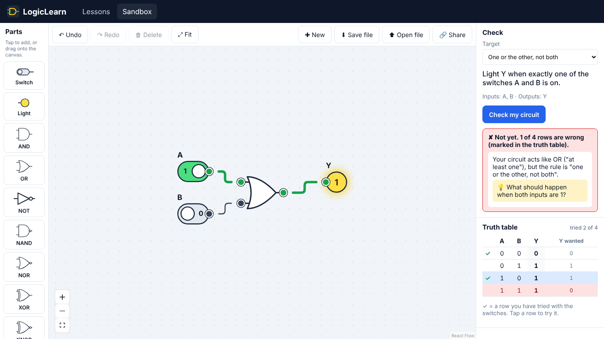

# Phase 1 report

**Status (2026-10-29):** Phase 1 tasks P1.0–P1.10 are built and tested on the branch
`claude/stoic-galileo-5wwq3b`. Merging to `main` deploys the site to
https://nat-160.github.io/LogicLearn/.

## What was built

| Plan task                        | Result                                                                                                                                                                                                                                                                          |
| -------------------------------- | ------------------------------------------------------------------------------------------------------------------------------------------------------------------------------------------------------------------------------------------------------------------------------- |
| P1.0 Scaffold and CI/CD          | Vite + React + TypeScript; ESLint, Prettier, Vitest, Playwright; GitHub Actions runs lint, format check, typecheck, unit tests, build and end-to-end tests (Chromium, touch, Firefox, WebKit), then deploys `main` to Pages. `CLAUDE.md` records the rules for future sessions. |
| P1.1 Circuit model               | `src/sim/circuit.ts`, `serialize.ts`: pure edit functions; untrusted JSON is validated and rebuilt field by field, with size limits.                                                                                                                                            |
| P1.2 Registry and parts          | Switch, light and the 7 gates, with `io` roles; 2–4 input gates supported by the simulator.                                                                                                                                                                                     |
| P1.3 Simulator                   | Event-driven, unit delay, tick budget, oscillation report, loop detection.                                                                                                                                                                                                      |
| P1.4 Truth table and checker     | Every row checked; structured diagnostics; gate constraints; misconception signatures (XOR for NAND, AND for XNOR, OR for XOR, AND for implication, missed all-zeros row).                                                                                                      |
| P1.5 Editor                      | React Flow canvas, hand-drawn ANSI gates, tap or drag to add, tap-to-connect, single-driver rule, undo/redo, delete, snap grid, live values, "never settles" banner, label/color inspector, tablet gesture handling.                                                            |
| P1.6 Truth table and check panel | Live table, current row, tap a row to set switches, tried-rows count, targets with expected column and wrong rows marked.                                                                                                                                                       |
| P1.7 Curriculum outline          | `docs/curriculum-outline.md` (step-level bullets for Lessons 0–9 and both projects).                                                                                                                                                                                            |
| P1.8 Milestone 1 demo            | `docs/milestone-1-demo.md` (5-minute script). The video itself is yours to record.                                                                                                                                                                                              |
| P1.9 Saving and sharing          | Autosave, circuit files, share links that open as a copy.                                                                                                                                                                                                                       |
| P1.10 Lesson framework           | Step types, Markdown text files with a draft marker, `npm run lessons:drafts`, progress store, steps unlock in order, hints, predict-first mode, the demo lesson _NOT and AND_, and content tests.                                                                              |

**Tests:** 101 unit tests and 19 end-to-end scenarios: 16 run both with a mouse and with
taps only, 3 keyboard scenarios run with a mouse. CI also runs them in Firefox and WebKit.

## Independent reviews

Two separate reviewer agents examined the code without seeing the author's reasoning.

- **Simulation core:** 4 confirmed defects and 4 minor ones, all fixed with regression
  tests. Examples: a file with extra fields could crash the simulator; a switch with the id
  `__proto__` stuck at 0; an oscillation report cleared too early. A 300-circuit fuzz
  test found no wrong logic values.
- **UI:** 8 confirmed defects, all fixed with regression tests. Examples: Ctrl+Z after a
  delete did nothing; Enter then Backspace in the label box deleted the part; an idle
  second tab could overwrite newer work; extra inputs made the wrong rows highlight.
  Most of its smaller concerns were also addressed.

## Changes from the plan

- Part _logic_ lives in `src/sim/components.ts` and part _drawings_ in `src/editor/nodes`
  (the plan had a separate `src/components/` folder).
- Gates are 80×80 px so every pin sits on the 20 px grid, which keeps wires straight.
- "Tried rows" restart whenever the circuit changes (the plan restarted them only when the
  inputs changed): tests of an old circuit say nothing about the new one.
- Hint text for misconception signatures is already in (planned for Phase 2).
- Browser support targets current desktop browsers (author's v3 answer); touch is tested
  by emulation only, not on a real iPad.

## Known limitations

- Lesson text is placeholder bullet points (`npm run lessons:drafts` lists them).
- Circuits can't be wired with the keyboard alone (toolbar, palette, check and truth
  table are keyboard-operable).
- The UI offers 2-input gates only; 3–4 input gates exist in the simulator.
- Progress lives in one browser; Safari may clear it after 7 days without a visit.
  Progress export/import is planned for Phase 2.
- Firefox and WebKit run in CI only (not in this development environment).
- The bundle is about 160 kB gzipped (mostly React and React Flow).

## Next (Phase 2, from the plan)

1. Lessons 1–4 (structure + draft text, for the author's final prose), progress gating
   between lessons, progress export/import.
2. Unit 1 project and the automatic grader's basic criteria.
3. Lessons 5–8, push button, seven-segment display, multi-color lights, Unit 2 project.
4. Prediction mode for truth tables, test-outs, remediation steps.
